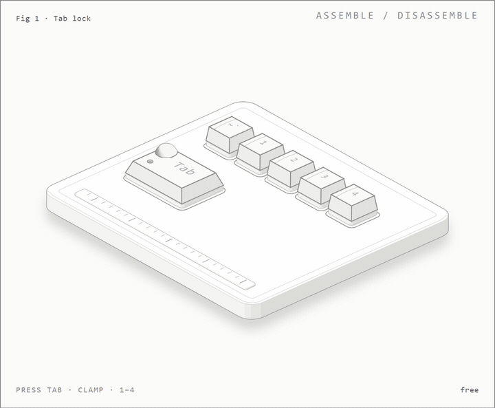

# TanTadiTaz: Tab-based AHK Workflow v.2.0

> An AutoHotkey script that turns your `Tab` key into a functional modifier layer. It moves Copy/Paste and navigation to the top row, eliminating the need to reach for `Ctrl`, `Alt`, or `Shift` at the bottom of the keyboard.

## 👀 A concept picture (not part of the script)

A concept animation. It is not a recording of the script.

The script itself is simple: you hold `Tab` with your own finger and tap a top-row key. `Tab` + `1` is Copy. You don't need a clamp, extra buttons or any hardware, just the `.ahk` file.

The picture above is a different thing. While I was thinking about this idea I sketched a concept keyboard where a small mechanical clamp holds `Tab` down, so the top row stays switched to Copy, Paste, Cut and Select All. I made it because a table of hotkeys is dull to read, and it's easier to picture the idea when you can see the keys move.

It's only a prototype drawing. Nothing like it ships with this repo, and there is no device you can buy or touch. If you want to build real key movements on the same idea, go for it, but that is a separate project.

## ⚡ The "Why" (Context)
This actually started as a hardware fix: I spilled juice on my keyboard and killed the bottom row (`Ctrl`, `Shift`). Instead of buying a new device immediately, I wrote code to remap the logic.

It turned out that **using the top row (`Tab` + Numbers) is significantly more ergonomic** than standard chords:
*   **Less wrist movement:** Your hand stays in the natural `WASD` / `QWERTY` position.
*   **Blind typing:** `Tab` and numbers 1-4 are tactile and easier to find in the dark than hunting for `Ctrl`.
*   **Speed:** I found I save time on shortcuts because my fingers don't have to "dive" to the bottom of the board.

I’ve been using this daily for a while now. It takes about ~2 days to build muscle memory, but going back to standard `Ctrl+C` feels slow afterwards.

---

## ⌨️ Key Mappings

**Logic:** Hold `Tab` to activate the command layer. Release `Tab` quickly to use it as a normal Tab key (handled via AHK `KeyWait`).

### 1. Clipboard Operations (Top Row Numbers)
Mnemonic aid (Ta-n, Ta-di, Ta-z):

| Shortcut | Action | Mnemonic |
| :--- | :--- | :--- |
| `Tab` + `1` | **Copy** (`Ctrl+C`) | Ta-**n** (One) |
| `Tab` + `2` | **Paste** (`Ctrl+V`) | Ta-**di** (Double) |
| `Tab` + `3` | **Cut** (`Ctrl+X`) | Ta-**z** (CutZ) |
| `Tab` + `4` | **Select All** (`Ctrl+A`) | Ta-**La** (All) |

### 2. Editing & Navigation (QWERTY Row)
Allows for text editing using only the left hand.

*   **Edit:**
    *   `Tab` + `Q` → Delete edges / word (Context dependent)
    *   `Tab` + `W` → `Delete`
    *   `Tab` + `Z` → **Undo** (`Ctrl+Z`)
    *   `Tab` + `S` / `D` → `Enter` (Useful for form filling)

*   **Selection (Text jumping):**
    *   `Tab` + `E` / `R` → Select by **Letter** (Left / Right)
    *   `Tab` + `C` / `V` → Select by **Word** (Left / Right)

### 3. File Explorer Extras
Active when focus is on Windows Explorer or file lists.
*   `Tab` + `X` → Select all files
*   `Tab` + `B` → Deselect all
*   `Tab` + `A` / `F` → Quick insert "00" or dot (.) for renaming.

---

## 🛠 Installation & Usage

1. Install [AutoHotkey](https://www.autohotkey.com/) (Check code for v1.1 or v2.0 compatibility).
2. Download `TanTadiTaz_v2.ahk` from this repository.
3. Double-click the script to run.

### System Controls
Since `Tab` is hijacked, standard `Alt+Tab` behavior might be affected.
*   **ScrollLock**: Toggles the script (Suspend). Use this if you need a "clean" Tab key for gaming or other apps.
*   **Alt + F4**: Remapped to `F11` (Safety feature to prevent accidental closing).
*   **Emergency Exit**: `Ctrl+Alt+Shift+Win+F12` (Kills the script immediately).

---

## ⚠️ Known Issues / Trade-offs

Just being honest about the friction points:
1.  **Alt-Tab:** Switching windows might feel different or require suspending the script depending on your OS settings.
2.  **Input Lag:** Because AHK intercepts `Tab`, there is a tiny delay when sending a "real" Tab keystroke (it waits to see if you are pressing a secondary key).
3.  **IDE Conflict:** Can conflict with code editors that use `Tab` heavily for autocomplete (IntelliSense). I recommend adding `IfWinNotActive` exceptions for your specific IDE.

## License
MIT. Feel free to fork and adapt to your workflow.

---
*Created by Aleksandrs M. Orrin. Code is ugly, but it works.*